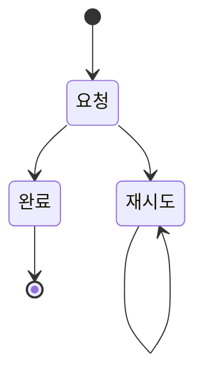

아래 내용 그대로 docs/adr/0001-refund-state.md 를 만들어줘. 다른 일은 하지 말고, 작업 중에 받은 알림이 있으면 그대로 알려줘.

````markdown
# 0001 환불 상태

## 배경
결제 취소 시 환불 상태를 정한다.

## 요구
- R-1 환불은 1분 안에 끝난다

## 결정
- R-1 을 위해 상태 기계로 관리한다



## 고려한 대안
- 동기 호출

## 위험
- 결제사 장애

## 확인 방법
- 환불 소요 시간 지표
````
